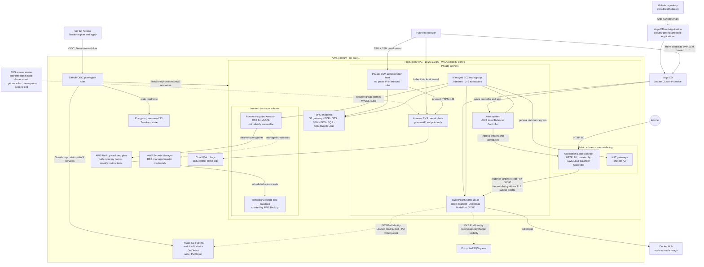

# AWS platform architecture

This diagram describes the production configuration across the infrastructure and delivery repositories. Terraform creates the AWS foundation and EKS access prerequisites; the delivery repository bootstraps Argo CD with Helm and stores the GitOps configuration.

## Production overview

## Ownership and deployment sequence

1. **Infrastructure repository:** Terraform provisions the VPC, subnets, gateways/endpoints, private EKS cluster and node group, SSM administration host, RDS MySQL and backup configuration, S3/SQS dependencies, workload IAM roles/Pod Identity associations, and load balancer controller IAM prerequisites.
2. **Infrastructure CI:** GitHub Actions assumes scoped plan/apply roles through GitHub OIDC. Terraform state is stored in the encrypted, versioned S3 backend. Public GitHub-hosted runners do not connect to the private Kubernetes API.
3. **Cluster access:** An authorized operator starts an SSM remote-host port-forward through the private admin host, then runs `kubectl` locally through the tunnel. The host and configured platform administrator role are cluster-admin principals. Optional namespace editor role ARNs receive access only in the configured application namespace.
4. **Delivery repository:** After the cluster is reachable, an operator runs the idempotent Helm bootstrap for Argo CD. Argo CD then reads the delivery repository's `main` branch and reconciles the AWS Load Balancer Controller and the application.
5. **Application traffic:** The controller creates an internet-facing HTTP ALB from the Ingress. The ALB forwards to worker-node NodePort `30080`; the application NetworkPolicy allows ingress only from the configured public ALB subnet CIDRs. HTTPS requires a domain and ACM certificate configuration.

## Important boundaries

- The EKS API is private; the public ALB exposes only the application endpoint, not Kubernetes or Argo CD.
- Argo CD is installed by the delivery repository's Helm bootstrap, not by the Terraform environment root. It is a private `ClusterIP` service.
- The application service account receives scoped S3 and SQS permissions through EKS Pod Identity. The sample image does not itself connect to the provisioned database, buckets, or queue.
- The RDS security group allows MySQL from the EKS node security group. This is network reachability, not proof that the sample application uses the database.
- AWS Backup is configured for daily backups and weekly restore testing; a successful restore should be verified from AWS Backup recovery/test results before claiming recovery has been demonstrated.
- Production values shown here are environment-specific. The Terraform modules and environment inputs are reusable, but delivery repo cluster/VPC/subnet values must be supplied for each additional environment.

## Source repositories

- [Infrastructure and Terraform](https://github.com/Raymondo-hub/swordhealth-aws-eks-terraform-challenge)
- [Application delivery and GitOps](https://github.com/Raymondo-hub/swordhealth-deploy)
